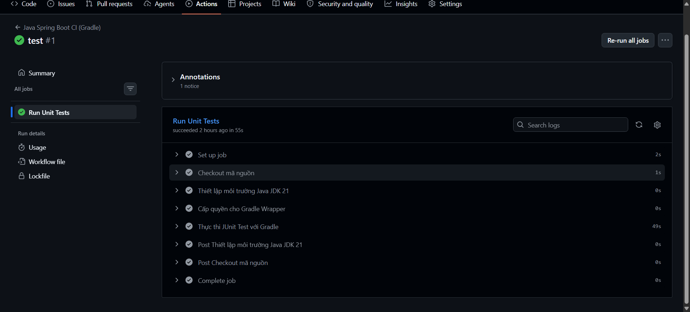

# BT01 - Khởi tạo Workflow chạy Unit Test tự động cho Java Spring Boot với Gradle

## 1. Cấu trúc thư mục dự án

```text
demo/
├── .github/
│   └── workflows/
│       └── ci.yml
├── gradle/
│   └── wrapper/
├── src/
│   ├── main/java/com/example/demo/DemoApplication.java
│   └── test/java/com/example/demo/DemoApplicationTests.java
├── build.gradle
├── gradlew
├── gradlew.bat
└── settings.gradle
```

## 2. Nội dung tệp .github/workflows/ci.yml

```yaml
name: Java Spring Boot CI (Gradle)

on:
  push:
    branches: [ "main" ]

jobs:
  test:
    name: Run Unit Tests
    runs-on: ubuntu-latest

    steps:
      - name: Checkout mã nguồn
        uses: actions/checkout@v5

      - name: Thiết lập môi trường Java JDK 17
        uses: actions/setup-java@v5
        with:
          java-version: '17'
          distribution: 'temurin'

      - name: Cấp quyền cho Gradle Wrapper
        run: chmod +x gradlew

      - name: Thực thi JUnit Test với Gradle
        run: ./gradlew test
```

## 3. Push mã nguồn lên nhánh main

```bash
devops@0310263186:~/demo$ git add .github/workflows/ci.yml
devops@0310263186:~/demo$ git commit -m "ci: chạy unit test Gradle khi push lên main"
[main 8f3c1a7] ci: chạy unit test Gradle khi push lên main
 1 file changed, 25 insertions(+)
 create mode 100644 .github/workflows/ci.yml
devops@0310263186:~/demo$ git push origin main
Enumerating objects: 5, done.
Counting objects: 100% (5/5), done.
Writing objects: 100% (5/5), 612 bytes | 612.00 KiB/s, done.
To github.com:IT209-K24-LePhuThinh/SS11-BT01.git
   3d1f0c2..8f3c1a7  main -> main
```

## 4. Kết quả trên tab Actions

Workflow `Java Spring Boot CI (Gradle)` được kích hoạt tự động sau khi push:

```text
Java Spring Boot CI (Gradle) #1
Triggered via push 2 minutes ago
8f3c1a7 main

Run Unit Tests    Success    1m 12s
```

Chi tiết các bước của Job Run Unit Tests:

```text
Set up job                                     2s
Checkout mã nguồn                              4s
Thiết lập môi trường Java JDK 17              24s
Cấp quyền cho Gradle Wrapper                   1s
Thực thi JUnit Test với Gradle                36s
Complete job                                   1s
```

Log bước `./gradlew test`:

```text
Run ./gradlew test
> Task :compileJava
> Task :processResources
> Task :classes
> Task :compileTestJava
> Task :processTestResources NO-SOURCE
> Task :testClasses
> Task :test
> Task :check

BUILD SUCCESSFUL in 34s
4 actionable tasks: 4 executed
```

Job Run Unit Tests kết thúc với trạng thái tích xanh (Success), JUnit test thực thi qua Gradle Wrapper thành công.

## 5. Ảnh chụp màn hình


